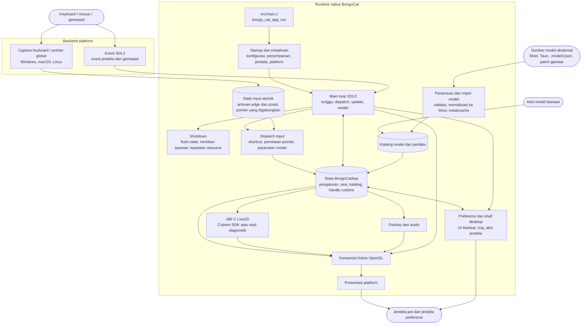

<div align="center">
  <a href="https://bongocat.pet" target="_blank">
    
  </a>

  <h1>
    <a href="https://bongocat.pet" target="_blank" style="text-decoration: none; color: inherit;">BongoCat Turbo</a>
  </h1>
</div>


<!-- Deskripsi Proyek + Ikon Roket -->
<p align="center">
 💘C/C++ × SDL3 × OpenGL, campur semuanya, satukan! Bong~ Bongo Cat!!!
</p>
<p align="center">Fork BongoCat yang dioptimalkan untuk performa: lebih hemat memori, lebih sedikit lag, plus backend Vulkan dan latar belakang transparan OpenGL.</p>
<p align="center">
<a href="https://github.com/Fid-falling/bongocat-turbo/blob/main/README.en-US.md">English</a> • <a href="https://github.com/Fid-falling/bongocat-turbo/blob/main/README.md">简体中文</a> • <a href="https://github.com/Fid-falling/bongocat-turbo/blob/main/docs/README.zh-Hant.md">繁體中文</a> • <a href="https://github.com/Fid-falling/bongocat-turbo/blob/main/docs/README.fr-FR.md">Français</a> • <a href="https://github.com/Fid-falling/bongocat-turbo/blob/main/docs/README.de-DE.md">Deutsch</a> • <a href="https://github.com/Fid-falling/bongocat-turbo/blob/main/docs/README.ko-KR.md">한국어</a> • <a href="https://github.com/Fid-falling/bongocat-turbo/blob/main/docs/README.pt-BR.md">Português</a> • <a href="https://github.com/Fid-falling/bongocat-turbo/blob/main/docs/README.ru-RU.md">Русский</a> • <a href="https://github.com/Fid-falling/bongocat-turbo/blob/main/docs/README.es-ES.md">Español</a> • <strong>Bahasa Indonesia</strong>
</p>
<p align="center">
  <a href="https://github.com/Fid-falling/bongocat-turbo/blob/main/LICENSE"></a>
  <a href="https://github.com/Fid-falling/bongocat-turbo"></a>
<a href="https://discord.gg/vf8jqnattk"></a>
  <a href="https://github.com/Fid-falling/bongocat-turbo/blob/main/docs/wechat.png"></a>
  <a href="https://qm.qq.com/q/cYlRBbvuda"></a>
</p>


<!-- Video Demo -->
<div align="center" style="margin-bottom: 30px;">
  <video src="https://github.com/user-attachments/assets/75719230-9e49-4124-ae5a-8e35592c5d49" autoplay loop style="border-radius: 8px; max-width: 800px;"></video>
</div>


> [!TIP]
> Model yang ditampilkan dalam demo ini berasal dari [宇痕冫](https://space.bilibili.com/348616056).
>
> 🎁 Mencari model **gratis**? Kami bekerja sama dengan kreator model berbakat untuk menghadirkan beragam model gratis, sambil terus mengeksplorasi pengalaman desktop yang lebih seru! Kunjungi situs resmi kami: [bongocat.pet](https://bongocat.pet/models)

<p align="center">
  <a href="https://bongocat.pet/models">
    
  </a>
</p>

<p align="center">
    
  </p>

## 📥 Unduh

Unduh rilis terbaru dari [GitHub Releases](https://github.com/Fid-falling/bongocat-turbo/releases/latest).

## 🛠️ Membangun dari Kode Sumber

BongoCat menggunakan CMake dan memerlukan compiler C11, compiler C++17, CMake 3.24
atau yang lebih baru, serta file pengembangan OpenGL desktop. SDL3, yyjson, stb,
miniaudio, dan Nuklear secara default diunduh saat proses konfigurasi, sehingga
konfigurasi pertama memerlukan akses jaringan.

Jalankan perintah berikut dari root proyek (direktori yang berisi
`CMakeLists.txt`).

### 📋 Prasyarat Platform

- **Windows:** Visual Studio 2022 dengan workload Desktop C++ dan CMake.
  Gunakan generator MSVC; MinGW dapat membangun backend diagnostik tetapi tidak
  didukung untuk Cubism SDK.
- **macOS:** Xcode Command Line Tools, CMake, dan Ninja. Pilih arsitektur dengan
  `CMAKE_OSX_ARCHITECTURES` jika berbeda dari default host.
- **Linux (Debian/Ubuntu):** GCC atau Clang, Ninja, serta header OpenGL/X11:

  ```bash
  sudo apt-get update
  sudo apt-get install -y build-essential cmake ninja-build \
    libgl1-mesa-dev libx11-dev libxi-dev libxfixes-dev
  ```

### 🔧 Konfigurasi dan Build

Di Linux dan macOS, gunakan generator single-configuration seperti Ninja:

```bash
cmake -S . -B build -G Ninja \
  -DCMAKE_BUILD_TYPE=Release \
  -DBONGO_CAT_FETCH_DEPS=ON
cmake --build build --parallel
```

Di Windows, jalankan dari shell developer Visual Studio 2022 (atau shell lain
yang menyediakan MSVC):

```powershell
cmake -S . -B build -G "Visual Studio 17 2022" -A x64 `
  -DBONGO_CAT_FETCH_DEPS=ON
cmake --build build --config Release --parallel
```

File executable dihasilkan di `build/BongoCatTurbo` pada Linux, di
`build/BongoCatTurbo.app/Contents/MacOS/BongoCatTurbo` di macOS, dan ke
`build/Release/BongoCatTurbo.exe` untuk build Visual Studio.

### 🧪 Pengujian

Target CTest diaktifkan secara default. Jalankan setelah proses build:

```bash
ctest --test-dir build --output-on-failure
```

Untuk generator multi-configuration seperti Visual Studio, pilih konfigurasi
build secara eksplisit:

```powershell
ctest --test-dir build -C Release --output-on-failure
```

### 🎭 Live2D / Cubism SDK (Opsional)

Jika Cubism SDK tidak tersedia, CMake akan menampilkan peringatan dan membangun
backend diagnostik. Backend ini ditujukan untuk diagnostik startup dan platform;
backend ini tidak menyediakan rendering model Live2D. Untuk membangun runtime
lengkap, pasang Cubism SDK for Native yang kompatibel lalu tempatkan di
`vendor/CubismSdkForNative` atau berikan lokasinya secara eksplisit:

```bash
cmake -S . -B build -G Ninja \
  -DCMAKE_BUILD_TYPE=Release \
  -DBONGO_CAT_CUBISM_SDK=/path/to/CubismSdkForNative \
  -DBONGO_CAT_REQUIRE_CUBISM=ON
```

SDK harus berisi Core library, source Framework, dan tree third-party OpenGL GLEW
dengan tata letak yang diharapkan oleh `cmake/Cubism.cmake`. Build Cubism di
Windows memerlukan Visual Studio 2022. `BONGO_CAT_REQUIRE_CUBISM=ON` membuat
konfigurasi gagal alih-alih diam-diam memilih backend diagnostik.

### ⚙️ Opsi CMake

| Opsi | Default | Deskripsi |
| --- | --- | --- |
| `BONGO_CAT_FETCH_DEPS` | `ON` | Unduh dependency pihak ketiga yang versinya dipin menggunakan CMake `FetchContent`. Atur ke `OFF` hanya jika SDL3, yyjson, stb, miniaudio, dan Nuklear sudah tersedia untuk CMake. |
| `BONGO_CAT_CUBISM_SDK` | `vendor/CubismSdkForNative` | Path ke Cubism SDK for Native. |
| `BONGO_CAT_REQUIRE_CUBISM` | `OFF` | Gagalkan konfigurasi jika Cubism SDK yang dapat digunakan tidak tersedia. |
| `BONGO_CAT_WARNINGS_AS_ERRORS` | `OFF` | Perlakukan warning compiler native sebagai error. |

Untuk build offline dengan `BONGO_CAT_FETCH_DEPS=OFF`, sediakan konfigurasi
package CMake untuk SDL3 (termasuk `SDL3-static`) dan yyjson, serta direktori
include untuk stb, Nuklear, dan miniaudio jika tidak dapat ditemukan secara
otomatis:

```bash
cmake -S . -B build -G Ninja \
  -DCMAKE_BUILD_TYPE=Release \
  -DBONGO_CAT_FETCH_DEPS=OFF \
  -DBONGO_CAT_STB_INCLUDE_DIR=/path/to/stb \
  -DBONGO_CAT_NUKLEAR_INCLUDE_DIR=/path/to/nuklear \
  -DBONGO_CAT_MINIAUDIO_INCLUDE_DIR=/path/to/miniaudio
```

## 📌 Status Proyek

* Grafis: Vulkan secara bawaan (OpenGL sebagai cadangan); keduanya dibangun dan diuji pada setiap perubahan.

## 📜 Lisensi

Kode sumber dan runtime native BongoCat dilisensikan di bawah
[AGPL-3.0-only](../LICENSE).

Mode model bawaan default (`standard`) tetap berlisensi MIT. Aset model yang
disertakan dalam `resources/assets/models/standard`, `keyboard`, dan `gamepad`
dilindungi oleh [pemberitahuan lisensi MIT](../LICENSE-MIT) terpisah.
Lisensi MIT tersebut hanya berlaku untuk aset model dan artwork pendampingnya;
lisensi tersebut tidak mengubah lisensi kode sumber atau runtime native BongoCat.

## 🧭 Arsitektur Teknis

> Versi native saat ini dibangun dengan C/C++, SDL3, dan OpenGL. Diagram di bawah berfokus pada aliran data runtime; detail build dan packaging berada di CMake.

### 🔄 Kepemilikan Runtime dan Penjadwalan Frame

Setiap proses memiliki satu `BongoCatApp` serta satu event loop dan render loop
di thread utama. Listener platform berhenti pada batas input:

```text
Listener platform
(keyboard / pointer)
            |
            v
  state input C11
  (antrean edge atomik + posisi pointer yang digabungkan)
            |
            v
  aplikasi thread utama <----- event SDL3
            |
            v
  parameter model, overlay, dan state UI
            |
            v
  update model -> komposisi OpenGL -> presentasi platform
```

Penerima Raw Input Windows, event tap Quartz macOS, dan listener XInput2 Linux
berjalan di luar main loop. Mereka memublikasikan edge tombol dan mouse dengan stempel waktu ke antrean
atomik berbatas dan menggabungkan gerakan pointer secara terpisah, sehingga
gerakan berfrekuensi tinggi tidak menggeser edge tombol dan mouse yang
berurutan. Event SDL membangunkan thread utama.
Windows memakai jendela khusus pesan dengan `RIDEV_INPUTSINK | RIDEV_DEVNOTIFY`
untuk menerima input latar belakang sambil mempertahankan pesan jendela biasa.
Model memakai gerakan perangkat ketika aplikasi lain menyembunyikan atau mengunci
kursor; SDL menyediakan posisi kursor desktop. Penerima melacak input yang tertahan per perangkat dan membersihkannya saat
perangkat dilepas atau desktop input berganti. Windows tidak memasang hook
input, tidak memakai DirectInput, dan tidak mengirim input ke game. Event jendela SDL3, preferensi, dan gamepad ditangani di thread utama,
tempat event gamepad dinormalisasi sebelum mencapai parameter model atau
shortcut. Tidak ada listener platform yang memanggil kode Live2D, overlay, atau
UI secara langsung.

`bongo_cat_app_run` menangani update-shutdown dan argumen proses sekunder,
memastikan kepemilikan single-instance untuk proses utama, mengalokasikan state
aplikasi, menjalankan inisialisasi, masuk ke `bongo_cat_app_loop`, lalu melakukan
flush state dan menghancurkan resource dalam urutan yang terdefinisi.
Inisialisasi memuat konfigurasi dan path penyimpanan, menemukan aset, membuat
jendela pet SDL/OpenGL, menginisialisasi backend platform, membuat layanan
Live2D, overlay, dan audio, memindai sumber model bawaan/terpasang/terdekat, lalu
memuat model yang dapat digunakan. `BongoCatApp` memiliki pengaturan, state
sesi, katalog model dan perilaku, handle platform, serta handle layanan runtime.

Paket model yang terpasang menggunakan Mver sebagai format kanonis. Workflow
impor menentukan file atau direktori yang dipilih, menemukan dan memvalidasi
kandidat, membuat fingerprint identitas paket, mengonversi sumber Tauri ke Mver,
menerapkan patch gambar, lalu menyimpan paket yang sudah dinormalisasi di bawah
`models_root`. Setelah itu, workflow menghasilkan adapter runtime dan
memperbarui katalog. Sumber terdekat ditemukan tanpa memasang source tree-nya;
adapter dan hasil inspeksinya di-cache di luar `models_root` di bawah
`cache_root`.

Setiap iterasi main loop menunggu sinyal wakeup SDL/native atau deadline frame, UI,
animasi, atau pointer-hit terdekat yang masih tertunda (dengan waktu tunggu
maksimum 250 ms). Iterasi tersebut mendispatch event SDL yang mengantre,
menguras antrean input atomik dan release recovery, memperbarui state jendela
dan model-refresh, serta menerapkan parameter yang berasal dari input. Saat
Cubism aktif, deadline model mengikuti `settings.model.max_fps` (default 60 FPS);
build diagnostik menggunakan interval fallback 100 ms. Waktu model yang berlalu
dibatasi hingga 250 ms dan dibagi menjadi maksimal delapan substep, dengan
target tidak lebih dari 1/30 detik per substep.

Jalur render pet normal hanya melakukan render saat jendela terlihat, tidak diminimalkan,
dan ditandai dirty. Sebuah frame membersihkan latar belakang, menggambar model, dan
mengomposisikan overlay pointer, tombol, dan efek sebelum memanggil presenter
platform. Operasi preview dapat meminta render langsung, sedangkan render
capture dapat melewati presentasi. macOS dan Linux menukar jendela SDL OpenGL
secara langsung. Windows melakukan swap langsung saat layered presentation tidak
aktif; jika aktif, Windows membaca kembali frame untuk `UpdateLayeredWindow`.
UI preferensi memiliki jendela SDL/OpenGL terpisah yang dirender dan
dipresentasikan secara independen dari jendela pet.

Runtime C memanggil ABI yang dideklarasikan di `include/bongo_cat/model.h`.
Bridge Live2D dan implementasi Cubism berada di `src/live2d` dan hanya
menggunakan C++17 saat Cubism SDK diaktifkan; runtime native lainnya menggunakan
C11. Tipe Cubism tetap berada di balik handle C yang opaque, sedangkan
`src/live2d/live2d_stub.c` menyediakan backend diagnostik ketika SDK tidak
tersedia.



## ❓ FAQ

### 🔒 Apakah BongoCat merekam input keyboard atau mouse saya?

Tidak. BongoCat memproses input keyboard dan mouse secara lokal untuk
menggerakkan animasi dan shortcut. BongoCat tidak merekam atau mengunggah
keystroke, aksi mouse, atau data interaksi lainnya. Konfigurasi juga disimpan
secara lokal, dan aplikasi tidak memiliki iklan, alat analitik, atau kode
pelacakan pengguna. Saat pemeriksaan pembaruan dilakukan, aplikasi hanya meminta
metadata rilis publik; aplikasi tidak mengirim data input, konfigurasi, atau
penggunaan.

### 📦 Di mana BongoCat menyimpan berkasnya, dan bagaimana mengaktifkan mode portabel?

Secara bawaan, pengaturan, model, cache, log, dan state sesi tersimpan di folder data aplikasi per pengguna (`%LOCALAPPDATA%\BongoCat` di Windows, folder XDG di Linux, `~/Library` di macOS). `--storage-root=DIR` menimpa semua jalur tersebut untuk satu kali peluncuran.

**Mode portabel** (Pengaturan → Aplikasi → Mode portabel) memindahkan semua ke folder `BongoCatData` di samping executable. Saat diaktifkan, pengaturan dan model disalin ke sana; saat dinonaktifkan, isi yang hilang digabungkan kembali ke lokasi bawaan; cache tidak pernah disalin, tetapi dibuat ulang sesuai kebutuhan. Penandanya adalah `BongoCatData\portable.json`, jadi untuk pindah ke komputer lain atau USB, cukup salin program bersama folder tersebut — tidak perlu berkas lain. Hapus `portable.json` untuk kembali ke lokasi bawaan. Jendela pengaturan selalu menampilkan folder yang benar-benar dipakai.

### 🎭 Model Live2D tidak muncul. Di mana runtime Cubism Core?

BongoCat tidak menyertakan maupun mengunduhnya: dapatkan Cubism SDK for Native dari situs resmi Live2D lalu impor sekali — lihat [panduan unduh dan impor Live2D Cubism Core](live2d-core.md) (Bahasa Mandarin).

### Input Linux Wayland

X11 memakai XInput2 secara bawaan. Input evdev eksperimental untuk Wayland nonaktif secara bawaan. Setelah membaca [risiko izin input](../SECURITY.md#linux-input), Anda dapat mengaktifkannya secara eksplisit untuk satu kali peluncuran:

```sh
BONGOCAT_ENABLE_EVDEV=1 ./build/BongoCatTurbo
```

Sakelar ini tidak memberikan izin perangkat. Jangan menjalankan aplikasi sebagai root atau menambahkan akun ke grup `input` untuk itu. Input mentah bisa memuat ketikan dari kolom sandi dan pemantauan tidak otomatis berhenti saat layar dikunci atau sesi diganti. Pemantauan hanya berhenti bila aplikasi ditutup; menyembunyikan pet tidak menghentikannya. Jalankan tanpa variabel tersebut untuk kembali ke backend bawaan. Pelacakan mouse memakai gerakan perangkat tanpa akselerasi; penempatan jendela, klik-tembus, dan selalu di atas tetap bergantung pada compositor Wayland.

### 🖼️ Backend grafis mana yang dipakai?

Runtime native menyertakan **keduanya**, perender Vulkan dan OpenGL. Nilai bawaan `auto` memilih **Vulkan**, dan hanya mundur ke OpenGL bila pemeriksaan Vulkan gagal. Jalur Vulkan sudah setara fiturnya: perenderan Live2D, menu radial, pengambilan sampul model, audit bingkai, dan uji asap memakai lapisan atas yang sama dengan OpenGL dan menghasilkan keluaran yang sama.

Backend dipilih di Pengaturan (`renderer`), atau dipaksa dengan kunci yang sama di `settings.json`. Beberapa hal yang perlu diketahui:

* Jika jendela Pengaturan sendiri tidak tergambar dengan benar, Anda tidak terjebak: `--renderer=opengl` (atau yang lebih pendek `--opengl`) memaksa seluruh aplikasi ke OpenGL untuk satu kali jalan itu, dan **menang atas `settings.json` tanpa menulis ulang berkas tersebut**. Menu tray memiliki sakelar yang sama sebagai “Render backend: <saat ini> -> <target>”; mengubahnya (atau kontrol tersegmentasi di Pengaturan) menyimpan pengaturan dan memulai ulang aplikasi secara otomatis, sehingga backend baru langsung aktif. `--help` mencantumkan semua opsi dan variabel lingkungan. Jalankan `BongoCat --help` di terminal.
* Perender Vulkan dan jembatan Cubism **sengaja berbagi satu** `VkDevice`. Perangkat kedua dulu membuat crash di bawah overlay (RTSS / OBS / NVIDIA) yang mengasumsikan satu perangkat per proses.
* Di Windows 10 swapchain hanya menyediakan `OPAQUE`. Transparansi tetap berfungsi: kami coba `VK_COMPOSITE_ALPHA_PRE_MULTIPLIED_BIT_KHR` lebih dulu dan hanya mundur bila driver menolak.
* Dua alat audit (`live2d-visual-audit`, `live2d-viewer-audit`) masih butuh OpenGL karena merender bingkai offscreen sendiri. Sisanya tidak bergantung backend.
* Log awal selalu mencetak backend yang diminta dan yang benar-benar dipakai.
* Jika jendela sekunder (Pengaturan, menu radial) sama sekali tidak bisa menggambar dengan Vulkan — swapchain tidak dapat dibuat, atau frame berhenti dipresentasikan — jendela itu membangun ulang dirinya dengan OpenGL dan menyebutkannya di log. Backend jendela utama tidak terpengaruh. Perlu diingat bahwa jendela Pengaturan OpenGL di atas jendela utama Vulkan hanya dikomposit sebagian di Windows, jadi `--renderer=opengl` (yang mengganti keduanya) tetap merupakan jalan keluar yang lebih baik.
* Setel `BONGO_CAT_VULKAN_VALIDATION=1` untuk mengaktifkan lapisan validasi Vulkan (memerlukan lapisan SDK di `PATH`; log akan memberi tahu bila tidak ada).

## Status Proyek


## 🙏 Ucapan Terima Kasih
> [!TIP]
> Setiap langkah BongoCat digerakkan oleh semangat open source. Kami dengan tulus berterima kasih kepada seluruh kontributor komunitas atas kontribusi mereka tanpa pamrih (tercantum di bawah berdasarkan urutan tanggal kontribusi). Dukungan Anda membuat pengalaman pendamping desktop menjadi lebih bebas dan autentik.❤️‍🔥


<a href="https://bongocat.pet">
    
</a>


[linux.do](https://linux.do/t/topic/2845597)
---

<div align="center">

Copyright © 2026 - **BongoCat**\
Oleh vladelaina\
Dibuat dengan ❤️ & ⌨️

</div>
